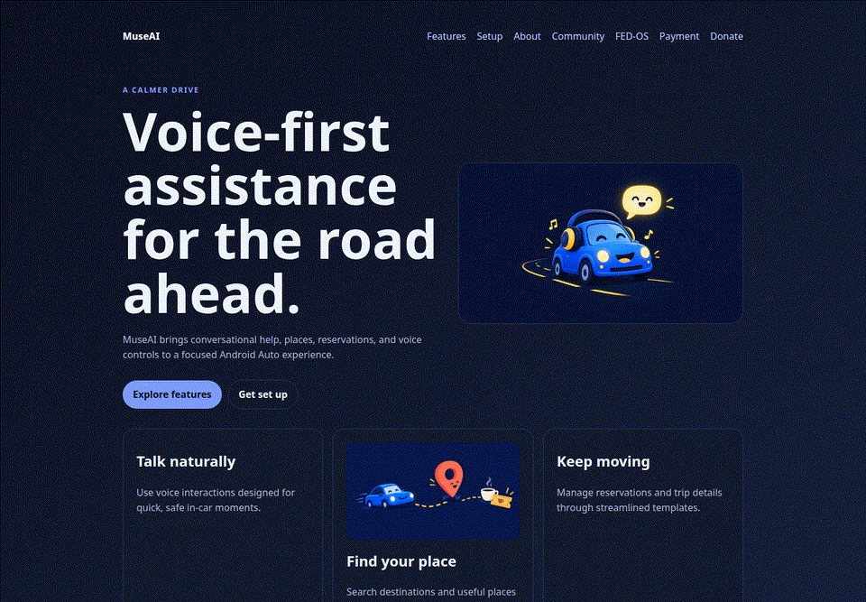
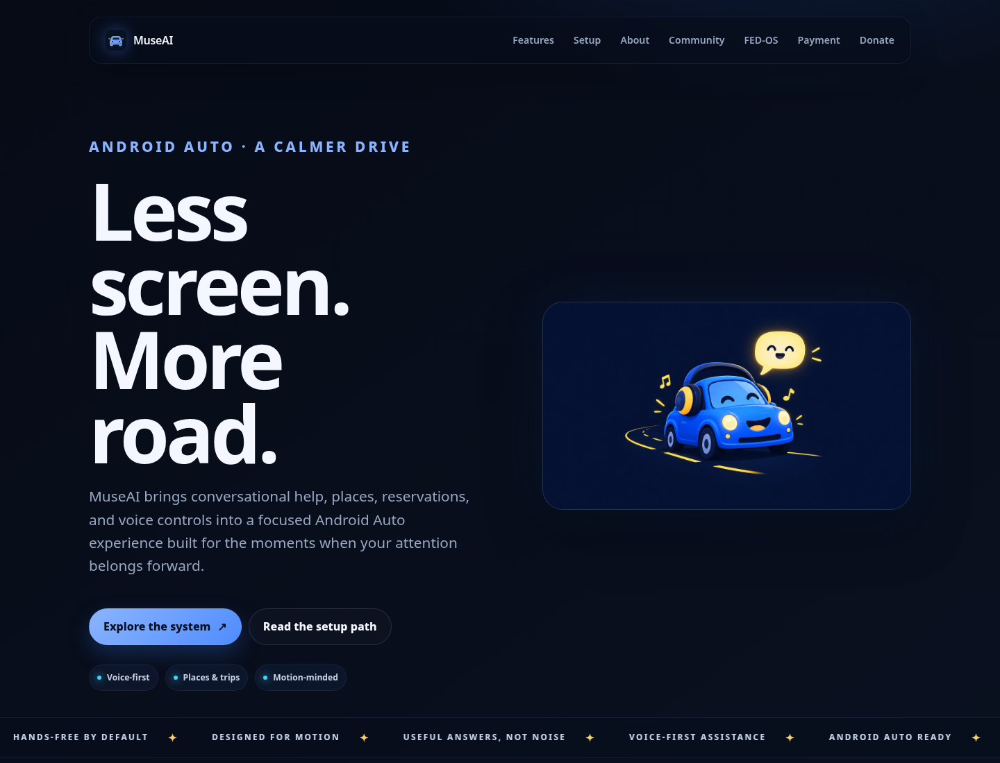
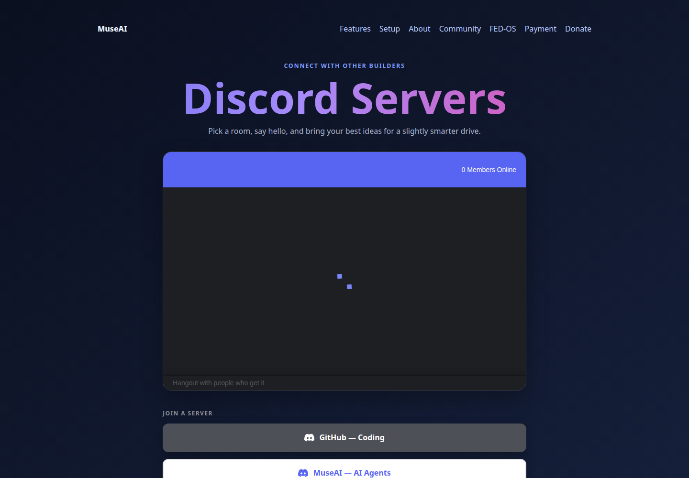
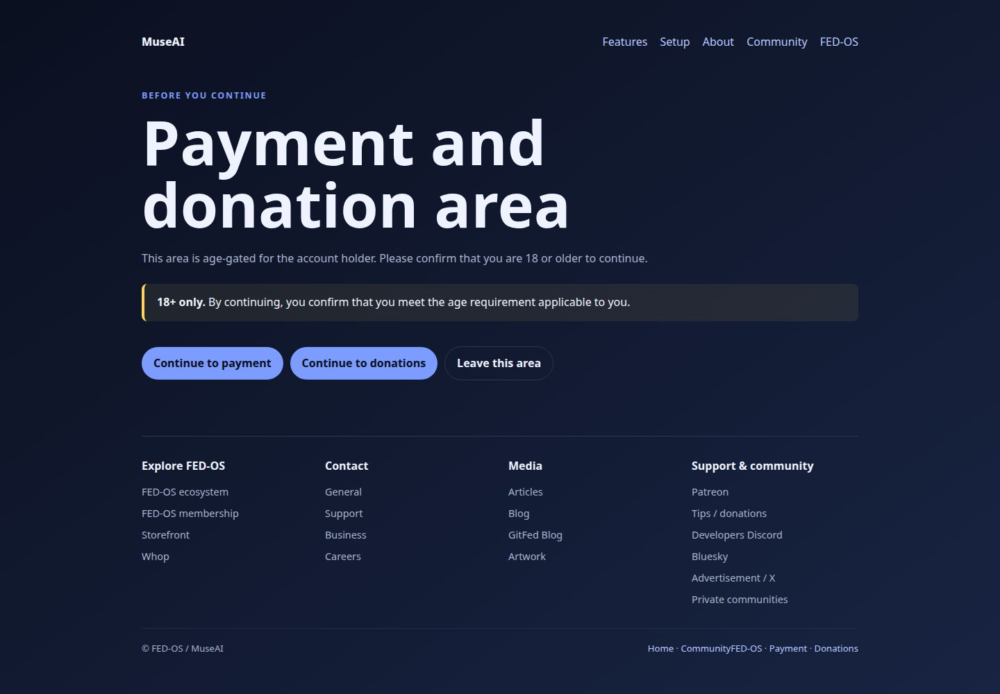

# MuseAI Android Auto

<video width="400" height="225" autoplay loop muted playsinline
       poster="first-frame.png"
       style="display: block; margin: 0 auto;">
  <source src="android-auto.webm" type="video/webm">
  <source src="android-auto.mp4" type="video/mp4">
</video>

A static, Pages-ready showcase and support hub for an Android Auto-focused MuseAI starter scaffold.

## Why this exists

An Android Auto concept is easy to describe and hard to make tangible. Visitors need a fast way to see the intended experience, find the setup notes, join the community, and understand which payment or support paths are real.

This repository makes that first step concrete with a small static site: a voice-first landing page, feature and setup pages, community links, age-gated payment and donation areas, and a public FED-OS footer. It is intentionally simple: plain HTML and CSS, relative links, and no build system to get in the way of a quick preview.

The important boundary is equally clear: this checkout does **not** contain a complete runnable complete runnable Android Auto app. The `MuseAndroidAuto/` directory currently contains only the legacy icon metadata, while `docs/ANDROID-AUTO-SETUP.md` documents the work still needed to wire a full Android Studio/Gradle target.

## See it work

**Live demo:** not available in this checkout. No repository remote or already-published Pages URL was present, so this README does not invent one.



The GIF above is captured from the actual local static site. It moves through the landing page, features page, community page, and age gate—not a mockup.

**Fastest local preview:**

```bash
python3 -m http.server 8765 --directory site
```

Open <http://127.0.0.1:8765/>. The main entry point is [`site/index.html`](site/index.html).

## Screenshots







## Quick start

No package installation is required.

```bash
# clone or download the repository
cd MuseAi-Android-Auto-App

# run the static site locally
python3 -m http.server 8765 --directory site

# open the site
# http://127.0.0.1:8765/
```

For a quick smoke check without a browser:

```bash
python3 - <<'PY'
from pathlib import Path
from html.parser import HTMLParser

root = Path("site")
class Page(HTMLParser):
    pass

pages = sorted(root.glob("*.html"))
for page in pages:
    Page().feed(page.read_text())
    assert '<link rel="icon"' in page.read_text(), page
print(f"Parsed {len(pages)} HTML pages")
PY
```

There is no automated native-app test suite or JavaScript package test command in this checkout. The smoke check above validates the static pages; payment, donation, Discord, and Matrix destinations require an internet-connected browser and their third-party services.

## What you can try immediately

- Start at [`site/index.html`](site/index.html) for the landing page and the two generated promotional illustrations.
- Open [`site/features.html`](site/features.html) to see the current feature framing.
- Open [`site/setup-guide.html`](site/setup-guide.html) for the practical Android Auto integration checklist.
- Open [`site/community.html`](site/community.html) for the Discord widget and server links.
- Open [`site/social.html`](site/social.html) for the FedPromptly invite-card modal and community link.
- Open [`site/payment.html`](site/payment.html) or [`site/donations.html`](site/donations.html) to exercise the age-gated payment/support paths.
- Open [`site/private-communities.html`](site/private-communities.html) to see the age-and-country gate before the private Matrix invite.

## Deployment

### GitHub Pages

A workflow is included at [`.github/workflows/pages.yml`](.github/workflows/pages.yml). It uploads the `site/` directory and deploys it with GitHub Pages on pushes to `main` or by manual dispatch.

To enable it in a real repository:

1. Push this project to GitHub.
2. In **Settings → Pages**, choose **GitHub Actions** as the source.
3. Push to `main` or run **Deploy static site** from the Actions tab.

This checkout has no Git remote and deployment has not been run here, so there is no live URL to report yet.

### Cloudflare Pages

The site is also compatible with Cloudflare Pages because it is plain static HTML/CSS/assets. Use these settings:

- **Build command:** leave blank
- **Output directory:** `site`
- **Root directory:** repository root

No Cloudflare project or deployment status is configured in this checkout.

## Project map

```text
.
├── site/                         # real runnable entry point: static Pages site
│   ├── index.html                # landing page
│   ├── features.html             # feature overview
│   ├── setup-guide.html          # HTML setup guide
│   ├── community.html            # Discord widget and invites
│   ├── social.html               # FedPromptly invite-card modal
│   ├── payment.html              # PayPal + Stripe embeds
│   ├── donations.html            # support and donation options
│   └── assets/demo/              # screenshots and real local demo GIF
├── MuseAndroidAuto/              # currently only legacy icon metadata
├── docs/ANDROID-AUTO-SETUP.md         # native Android Auto wiring notes
└── .github/workflows/pages.yml   # GitHub Pages deployment workflow
```

## Current limitations

- The native Android Studio project, Kotlin/Java source tree, service implementations, and unit tests described in the original scaffold are not present in this checkout.
- No live demo URL, Git remote, Gradle build files, package manifest, or lockfile is configured here.
- Payment, donation, Discord, and Matrix embeds depend on third-party providers and should be verified with their production account settings before launch.
- Age and country checks in the static pages are client-side UX gates, not a substitute for legal, account, or provider-side enforcement.

## License

No `LICENSE` file is present in this checkout, so no license badge or reuse permission is claimed here.
